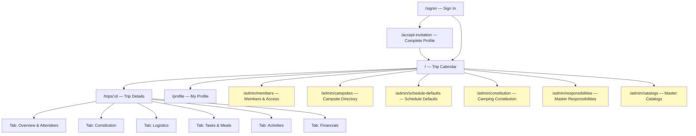

# Camping Club — UI Navigation Guide

This document describes every screen and navigation path in the Private Camping Club app, organized by role. For the technical architecture see `ARCHITECTURE.md`.

---

## Roles at a Glance

| Role | Access level |
|---|---|
| **member** | Calendar, trip details (all tabs), profile |
| **accountant** | All member access + deposit verification + full financials + settlement confirmation |
| **admin** | All accountant access + full admin panel + trip/event management |

> [!NOTE]
> Routes are enforced server-side by the Edge Functions and client-side by `AccessBoundary`. A role badge is never sufficient for authorization — the backend always re-validates.

---

## Global Header (All Roles)

The persistent header appears on every page:

| Element | Behavior |
|---|---|
| **🏕 Private Camping Club** logo | Navigates to `/` (calendar) |
| **User avatar button** (initials) | Opens the user dropdown menu |
| **Red badge on avatar** | Admin only — shows count of pending access requests |

### User Dropdown Menu

| Item | Visible to | Route |
|---|---|---|
| 👤 My Profile | All signed-in | `/profile` |
| 🏕️ Campsite Directory | Admin only | `/admin/campsites` |
| 👥 Members & Access | Admin only (badge shows pending count) | `/admin/members` |
| ⚙️ Club Schedule Defaults | Admin only | `/admin/schedule-defaults` |
| 📜 Camping Constitution | Admin only | `/admin/constitution` |
| 🛠️ Master Responsibilities | Admin only | `/admin/responsibilities` |
| 📦 Master Catalogs | Admin only | `/admin/catalogs` |
| 🚪 Sign out | All signed-in | Signs out → `/signin` |

### Pending Requests Banner

When there are pending member access requests, a yellow banner appears below the header (admin only):

> 🔔 **N new member access requests** waiting for approval. [Review & Approve →]

---

## Authentication Flow

### `/signin`
- Entry point for new and returning users.
- User enters **name** and **email** → system checks membership status via `auth-api.check_access`.
- If approved: OTP magic-link is emailed → user enters the 6-digit code to sign in.
- If not yet approved: request is created/acknowledged; user must wait for admin approval.

### `/accept-invitation`
- Reached when a user's auth session exists but their member profile is incomplete.
- **MemberProfileForm** collects: display name, phone number, preferred payment method (Venmo/Zelle/etc.).
- On save: profile is created and user is redirected to `/`.

### `/profile`
- Edit existing profile: display name, phone, payment method.
- Available to all active members.

---

## Calendar — `/` (Home)

The main landing page for all logged-in members.

### Trip Cards

Each month's trip appears as a card showing:

| Field | Notes |
|---|---|
| Trip title & month | e.g. "October Camping 2026" |
| Status badge | Tentative / RSVP Open / Confirmed / In Progress / Completed / Cancelled / Finalized |
| Dates | Start and end dates |
| Campsite name | Linked campsite from the rotation |
| Attendee count | "N Going · N Waitlisted" |
| My RSVP status | Going / Not Going / Waitlisted / No response |
| Cabin booking status | Booked / Pending / No Vacancy |
| Readiness scorecard | 4–5 item checklist (see below) |
| Duty badge | Shows if the member has claimed their chore quota |

Clicking a trip card navigates to `/trips/:tripId`.

### Readiness Scorecard (Member view on calendar card)

A compact checklist showing trip readiness. Each item shows ✅ when complete:

1. **✅ / ⬜ RSVP** — Going / Not Going submitted
2. **✅ / ⬜ 💵 $50 Deposit** — Deposit submitted or confirmed (exempt if cabin payer)
3. **✅ / ⬜ 🧹 Chores & Meals** — Duty quota met
4. **✅ / ⬜ 🍽️ Meal Preferences** — Only shown when RSVP is Going
5. **✅ / ⬜ 🎯 Activity** — Only shown when trip has a configured activity

### Admin-Only Actions on Calendar

Admin sees additional controls on each trip card:
- **Edit Event** button → opens the Edit Trip Modal (dates, campsite, minimum, capacity, booking status, additional info, title, event status, camping type)
- **Add Custom Camping** button → opens New Trip form to create a trip for a specific month
- **Delete** (inside the Edit modal) → irreversibly deletes the event after confirmation

---

## Trip Details — `/trips/:tripId`

Six tabs accessible to all members (with role-conditional controls within each):

```
[ Overview & Attendees ] [ Constitution ] [ Logistics ] [ Tasks & Meals ] [ Activities ] [ Financials ]
```

Tab state is preserved in the URL query string (`?tab=constitution`, `?tab=financials`, etc.).

---

### Tab 1 — Overview & Attendees

**All members see:**
- Trip header: title, dates, campsite, status, cabin booking status
- **RSVP panel**: Going / Not Going buttons with rule acknowledgment checkbox
  - If Going is selected for the first time, the member must check "I have read and agree to the Camping Constitution" (exact rule bundle version is stored)
  - A Confirm Going modal appears for first-time Going RSVPs
  - Late withdrawal warning (≤30 days before trip): displayed when switching from Going to Not Going
- **Waitlist position** banner if on the waitlist
- **Attendee list**: names of confirmed Going participants
- **Waitlist** section: shows waitlisted members (position and join time)

**Admin-only controls on Overview:**
- Edit Event button (opens modal with full trip configuration)
- Configure time slots button → AdminTimeSlotManagerModal (sets meal/chore schedule)
- **Admin Roster section**:
  - Full list of all members with their RSVP status and version
  - Toggle individual members Going / Not Going (admin override, with audit reason)
  - Promote from waitlist button (per waitlisted member)
  - Deposit status per member: Unpaid / Submitted / Confirmed / Exempt
  - **Verify Deposit** / **Mark Exempt** / **Reset** controls (admin + accountant)
- Withdrawal Requests panel (if any members have requested withdrawal)

---

### Tab 2 — Constitution

**All members see:**
- The Camping Constitution rendered from the current rule bundle
- Rules grouped by category: Travel & Cabin, Food & Expenses, Lodging & Responsibilities, Packing & Meals
- The exact version/hash of the bundle the member acknowledged when they RSVP'd Going
- Acknowledgment timestamp

**Admin-only controls:**
- Accessed via `/admin/constitution` (separate page, not within this tab)

---

### Tab 3 — Logistics

**All members see:**
- **Directions** to the campsite (from campsite record)
- **Carpool section**:
  - List of configured carpool vehicles with driver, seats, departure details, and assigned riders
  - Member's own carpool assignment highlighted
- **Commitments / Packing section**:
  - Individual Pack items: personal gear/food to bring; member can claim or unclaim items
  - Shared Volunteer items: group gear/food; member can volunteer or withdraw
  - Packing checklist (client-side checkbox state, stored in localStorage per trip+member)

**Admin-only controls on Logistics:**
- Create / Edit / Delete carpool vehicles (driver assignment, vehicle description, max seats, departure details, rider assignments)
- Sync commitments from Master Catalog button
- Add commitment item form (name, quantity, category: gear/food)
- Delete commitment items

---

### Tab 4 — Tasks & Meals

**All members see:**
- Chore and meal slots organized by day (Friday evening, Saturday morning, Saturday afternoon, Saturday evening, Sunday morning)
- Each duty row shows: responsibility title, time, capacity (spots taken / available), workload weight
- **Claim** button to volunteer for an available duty
- **Drop** button on duties already claimed by the member
- Members who have not RSVP'd Going see a banner and cannot claim duties

**Admin-only controls on Tasks & Meals:**
- **T-48h Duty Override Mode banner**: shows when unfilled slots remain and allows force-assigning members
- Force-assign member to any open duty slot
- Workload progress summary (targets vs. actual per member)

---

### Tab 5 — Activities

**All members see:**
- List of trip activities with: title, category, image, location, address, date/time, booking notes
- **Signature Activity** card (first/primary activity shown prominently)
- For each activity the member is attending:
  - **Participation choice**: Attending / Opted Out (if pairings not locked)
  - **Vehicle pairing**: who the member is paired with for the activity vehicle
  - **Voucher section**:
    - Status badge: Needed / Pending / Purchased / Verified / Exempt
    - 🎟️ Buy Voucher link (opens Groupon or configured booking URL)
    - Enter voucher details form: purchaser, voucher code, amount, date purchased
    - Members who purchased extra vouchers can enter all codes
  - **Waiver section** (shown only when activity has a waiver URL):
    - "Open Waiver" button → opens operator's waiver URL in new tab; click is recorded server-side
    - "I Have Signed the Waiver ✓" confirmation button (enabled only after waiver link is clicked at least once)
    - Confirmed waiver shows: "Thank you! Your signed waiver is confirmed on the tour operator call sheet."
  - **Swap Request**: notification if another member wants to swap vehicle pairings; Accept / Decline buttons
- **Opted Out** members see their opt-out status and a change button (if pairings not locked)

**Admin-only controls on Activities:**
- **Add Activity** form: title, category, image URL, location, address, directions URL, booking URL, voucher URL, waiver URL, booking notes, date, start/end time, unit label, unit capacity, opt-out policy, groupon flag
- **Edit Activity** (per activity)
- **Delete Activity** (with confirmation)
- **Adjust who paid vouchers**: Edit the purchaser member on any voucher entry
- **Activity pairings management panel**:
  - View all vehicle groups with members and their voucher/waiver status
  - Move member between groups (drag or select)
  - Auto-shuffle pairings button
  - Lock / Unlock pairings toggle (when locked, members cannot change participation or request swaps)
- **Tour Operator Call Sheet** button → opens a modal with the full roster including:
  - Each participant's name
  - Voucher status and code
  - Waiver status (clicked + signed badges)
  - Copy to clipboard function
- **Lock/Unlock Pairings** toggle

---

### Tab 6 — Financials

**All members see:**
- Settlement preview: their net balance (owe / receive)
- Transfer list: who owes whom and how much
  - "Mark Sent" button for transfers the member owes (self-report only; does not constitute proof)
  - "Confirm Received" button for transfers others owe to the member

**Accountant & Admin additionally see:**
- Full expense ledger
- Cabin deposit section: who paid, amount per attendee, confirmed count, total
- Trip expense list: each expense with payer, amount, date, split type, allocation details
- Settlement matrix: complete balance table for all attendees

**Admin-only controls on Financials:**
- Add expense form: type (cabin deposit / carpool mileage / shared receipt / website maintenance / other), payer, amount, date, split mode, allocations
- Edit expense: change any field including adjusting the payer (who paid)
- Delete expense
- Adjust who paid vouchers (can also be done from Activities tab)
- **Finalize Settlement** button: locks the settlement run; immutable after finalization
- Confirm settlement transfers on behalf of other members (Admin override)
- Receipt upload / view (PDF or image receipt viewer modal)

---

## Admin Panel Pages

### `/admin/members` — Members & Access

| Section | Controls |
|---|---|
| **Access Requests** | List of pending join requests; Approve / Reject buttons |
| **Invite by email** | Send invitation email to a new member |
| **Club Members list** | Full member roster with role and status |
| Per-member **Access** dropdown | Active / Inactive / Suspended |
| Per-member **Role** dropdown | Member / Administrator / Accountant |

Role and status changes are audited server-side. An audit entry is appended for every change.

---

### `/admin/campsites` — Campsite Directory

- Full list of campsites in the rotation with their rotation position
- Per campsite: name, location description, availability URL, estimated rate, cabin capacity, cabin types, directions, reservation instructions, camp host, camp features, cabin information, admin notes
- **Add campsite** form
- **Edit campsite** (opens inline or modal form)
- **Availability status** tracking: Sites Available / Booked / No Vacancy / Pending
- **Image URL** for campsite photo display

---

### `/admin/schedule-defaults` — Club Schedule Defaults

- **Club timezone** setting
- **Default poll lead days** (days before trip start that RSVP deadline is set; default 35)
- **Default poll close time** (time of day for deadline)
- **Default minimum participants** (default 4)
- **Next month to generate** and **next rotation position** (controls the auto-generation of future trip stubs)

---

### `/admin/constitution` — Camping Constitution Editor

- Full WYSIWYG / Markdown editor for the Camping Constitution rule bundle
- Rules organized by category (transport, cabin, expenses, conduct, lodging, participation, meals, custom)
- Each rule has a stable key, text, and structured values (e.g. deposit amount, withdrawal window)
- **Publish new version**: creates a new immutable rule bundle; existing acknowledgments reference the old bundle
- Version history view

---

### `/admin/responsibilities` — Master Responsibilities

- List of all reusable responsibility templates used in trip duty scheduling
- Each responsibility: title, category, workload weight, description
- **Add / Edit / Delete** responsibility templates
- These templates populate trip time slots when trips are configured

---

### `/admin/catalogs` — Master Catalogs

Four tabs:

#### Gear Tab
- List of master gear items with: name, gear type (individual / shared), category (shelter, kitchen, safety, tools, comfort, misc), default quantity, critical flag, description
- Filters: All / Individual / Shared
- **Add / Edit / Delete** gear items
- Critical items are highlighted and always appear at the top of packing lists

#### Food Tab
- List of master food items with: name, category (pantry, produce, dairy, protein, beverages, condiments, snacks, other), default quantity, critical flag, description
- **Add / Edit / Delete** food items

#### Responsibilities Tab
- Same content as the Master Responsibilities page, accessible from within the catalog view

#### Activities Tab
- List of master activity templates (reusable across trips)
- Each activity template: title, category (sightseeing, water, hiking, cultural, food, entertainment, sport, adventure, relaxation, other), description, image URL, typical booking URL, typical duration
- **Add / Edit / Delete** master activity templates
- Trip-specific activities can be created from these templates or from scratch

---

## Member Profile — `/profile`

- Edit display name
- Edit phone number (E.164 format)
- View and edit preferred payment method (Venmo / Zelle / PayPal / Apple Cash)
- View and edit payment handle or account email (e.g. `@venmo-handle`, Zelle phone/email); decrypted server-side for the member and preserved across profile reloads
- Changes are saved to the member record server-side

---

## Navigation Flow Diagram



> [!NOTE]
> Yellow nodes are **admin-only**. All members (including accountants) can access the calendar, trip details, and profile.

---

## Role Permission Matrix

| Action | member | accountant | admin |
|---|:---:|:---:|:---:|
| View trip calendar | ✅ | ✅ | ✅ |
| Submit RSVP (Going / Not Going) | ✅ | ✅ | ✅ |
| View attendee list | ✅ | ✅ | ✅ |
| Submit $50 deposit (self-report) | ✅ | ✅ | ✅ |
| View constitution & ack history | ✅ | ✅ | ✅ |
| View logistics & carpool | ✅ | ✅ | ✅ |
| Claim / drop chore duties | ✅ | ✅ | ✅ |
| Enter meal preferences | ✅ | ✅ | ✅ |
| Enter activity participation | ✅ | ✅ | ✅ |
| Enter voucher details | ✅ | ✅ | ✅ |
| Click waiver URL & confirm signed | ✅ | ✅ | ✅ |
| Request pairing swap | ✅ | ✅ | ✅ |
| View own settlement balance | ✅ | ✅ | ✅ |
| Mark transfer sent | ✅ | ✅ | ✅ |
| Confirm transfer received (self) | ✅ | ✅ | ✅ |
| **Verify member deposits** | ❌ | ✅ | ✅ |
| **View full expense ledger** | ❌ | ✅ | ✅ |
| **Confirm settlement transfers (any)** | ❌ | ✅ | ✅ |
| **Edit / add trip expenses** | ❌ | ❌ | ✅ |
| **Finalize settlement** | ❌ | ❌ | ✅ |
| **Override RSVP (roster management)** | ❌ | ❌ | ✅ |
| **Promote from waitlist** | ❌ | ❌ | ✅ |
| **Create / edit / delete trips** | ❌ | ❌ | ✅ |
| **Configure time slots (meal/chore schedule)** | ❌ | ❌ | ✅ |
| **Force-assign duties** | ❌ | ❌ | ✅ |
| **Manage carpool vehicles** | ❌ | ❌ | ✅ |
| **Add / edit / delete activities** | ❌ | ❌ | ✅ |
| **Manage activity pairings** | ❌ | ❌ | ✅ |
| **View Tour Operator Call Sheet** | ❌ | ❌ | ✅ |
| **Adjust voucher purchaser** | ❌ | ❌ | ✅ |
| **Manage members & roles** | ❌ | ❌ | ✅ |
| **Campsite directory** | ❌ | ❌ | ✅ |
| **Schedule defaults** | ❌ | ❌ | ✅ |
| **Constitution editor** | ❌ | ❌ | ✅ |
| **Master Responsibilities** | ❌ | ❌ | ✅ |
| **Master Catalogs** | ❌ | ❌ | ✅ |
