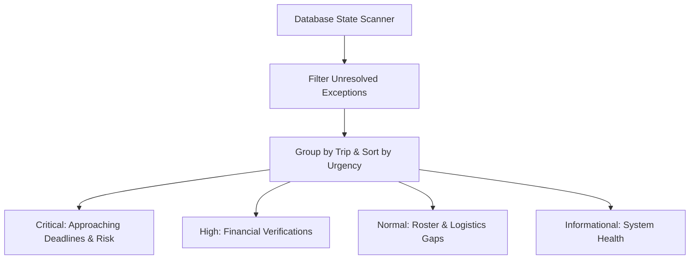

# Camping Club 2.0 — Admin Operations & Exception Management Specification

## 1. Philosophy: Exception-Driven Administration

Administrators should never be required to hunt through five tabs and thirty tables to determine whether an upcoming camping trip is on schedule. 

**Admin Operations** (`/admin/operations`) is an exception-management control center. It scans the entire club state and surfaces only those items that require human administrative intervention, decision-making, or verification.

---

## 2. Operational Domains & Exception Types

### Domain 1: Deadlines & Trip Viability (Critical Urgency)
- **Cabin Cancellation Buffer Alert:** Triggers 5 days before the contractual cabin cancellation deadline if attendance remains below the minimum threshold.
  - *Display:* `⚠️ Contractual Cabin Deadline in 5 Days: Nov 01, 2026. Current RSVPs: 3 (Minimum 4).`
  - *Action:* `[Manage Cabin & Cutoff]` (opens modal to extend cutoff, message members, or initiate cancellation).
- **Registration Cutoff Imminent:** Triggers 48 hours before poll deadline.
  - *Action:* `[Send Cutoff Reminder Notice]`.

### Domain 2: Attendee & Roster Management (High Urgency)
- **Waitlist Promotion Candidate:** Triggers when a confirmed attendee cancels, creating vacancy while an active waitlist exists.
  - *Display:* `👤 Spot Available: John Doe is #1 on the waitlist for November Camping.`
  - *Action:* `[Promote Camper to Confirmed]`.
- **Pending Member Access Request:** Triggers when an external user requests club membership.
  - *Display:* `🔑 Access Request: Alice Smith (alice@example.com) requested Member access.`
  - *Action:* `[Approve Member]` / `[Reject]`.

### Domain 3: Financial Verifications (Accountant & Admin)
- **Unverified Cabin Deposits:** Triggers when a member marks their $50 deposit as sent.
  - *Display:* `💰 2 Deposits Awaiting Verification: Bob Smith ($50.00 via Zelle), Carol Lee ($50.00 via Venmo).`
  - *Action:* `[Verify Bob Smith ($50.00)]` / `[Verify Carol Lee ($50.00)]`.
- **Post-Trip Settlement Ready:** Triggers 48 hours after a trip concludes when expenses have been submitted.
  - *Display:* `📊 Settlement Ready for Finalization: November Monterey Camping ($510.00 total expenses).`
  - *Action:* `[Review Ledger & Finalize Settlement]`.

### Domain 4: Logistics & Duty Coverage (Normal Urgency)
- **Vacant Critical Duties:** Triggers 7 days before departure if kitchen or safety duties are unclaimed.
  - *Display:* `🍳 2 Vacant Duty Credits: Saturday Breakfast Cook, Camp Water Lead.`
  - *Action:* `[Assign Member to Duty]`.
- **Carpool Deficit:** Triggers if confirmed campers exceed available vehicle seats.
  - *Display:* `🚗 Carpool Shortage: 12 campers confirmed, but vehicles seat only 10 (Deficit: 2).`
  - *Action:* `[Review Carpool Rosters]`.

### Domain 5: Activities, Vouchers & Waivers (High Urgency)
- **Unverified Operator Waivers:** Triggers when a member self-reports signing an external operator waiver.
  - *Display:* `📄 2 Waivers Unverified on Tour Call Sheet: GoCar Monterey Scenic Tour.`
  - *Action:* `[Review Operator Call Sheet]`.
- **Missing Activity Vouchers:** Triggers 5 days before departure for opted-in campers without voucher codes.
  - *Display:* `🎟️ 1 Voucher Code Missing: David Brown (GoCar Car #2).`
  - *Action:* `[Request Voucher Code]`.

---

## 3. Mobile Usability & Interaction Standards

To ensure zero friction on physical mobile devices (iPhone Safari / Android Chrome):
1. **Full-Width Touch Targets:** Every exception resolution button is rendered at `width: 100%`, with a minimum height of `44px` and comfortable vertical padding (`12px 16px`).
2. **Button Placement:** Action buttons sit directly beneath the descriptive text, never cramped into horizontal multi-column tables.
3. **Single-Click Contextual Routing:** Clicking an exception action button immediately opens the relevant input drawer or modal with the specific record pre-selected.
4. **Instant In-Memory Dismissal:** When an action succeeds (e.g. clicking `[Verify Bob Smith ($50.00)]`), the card is optimistically removed from the view with a clear toast confirmation.
