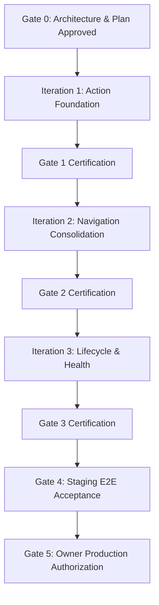

# Camping Club 2.0 — Phased Implementation Plan & Certification Gates

## 1. Governance & Execution Protocol

Implementation of Camping Club 2.0 proceeds through **three strict, sequential iterations**. Each iteration culminates in a formal human certification gate.

### Mandatory Rules
1. **Zero Greenfield Rewrite:** All work builds on top of existing Supabase tables, RLS policies, and Edge Functions.
2. **Worktree Isolation:** All code changes occur exclusively in `/Users/veerrajuamanchi/camping-club-v2` on branch `feature/camping-club-v2`.
3. **No Premature Implementation:** No application code may be written until the owner explicitly approves this plan at **Gate 0**.
4. **Mandatory Multi-Browser Gate:** Every iteration must pass unit, database, build, and automated Playwright browser tests across Desktop Chromium, iPhone Mobile WebKit, and Android Mobile Chromium before requesting gate approval.

---

## 2. Iteration Breakdown

### Iteration 1: Action-Oriented Foundation
**Objective:** Deliver the authoritative Action Resolution Service, simplified calendar cards, My Actions Hub, and the Admin Operations dashboard without touching existing sub-tabs.

- **Task 1.1 — Action Resolution Domain Engine:**
  - Pure TypeScript evaluator (`frontend/src/domain/actions/ActionResolutionService.ts`).
  - Unit tests covering all 15 action rules (`ACT-MEM-*` and `ACT-ADM-*`).
  - Workload credit evaluation including driver offset bonus (+1 credit for 3+ passengers).
- **Task 1.2 — Simplified Calendar Trip Cards:**
  - Shortened campsite hero banner (95px) using real photos from the Campsite Directory.
  - Contextual Next Action callout pill derived from the Action Resolution Service.
  - Distinct registration deadline row with Admin Override indicator.
  - Rapid RSVP toggle (`✓ Going` / `✕ Not Going`).
- **Task 1.3 — My Actions Hub (`/actions`):**
  - Unified personal task inbox across all active trips.
  - Categorization into Critical, Normal, and Informational.
  - Contextual deep links to exact resolution drawers.
- **Task 1.4 — Admin Operations Exception Dashboard (`/admin/operations`):**
  - Exception cards grouped by trip: deadlines, missing deposits, vacant chores, waitlist candidates.
  - Mobile full-width touch targets (minimum 44px height).
  - Single-click resolution routing.
- **Certification Gate 1 Requirements:**
  - Action counts update immediately when source records change.
  - Actions disappear when completion conditions are met.
  - Full Playwright E2E suite passes across Desktop, iPhone, and Android.

---

### Iteration 2: Navigation Consolidation & Feature Preservation
**Objective:** Refactor Event Details into the approved four destinations (`Overview`, `Prepare`, `Activities`, `Payments`), implement the 3 Prepare accordions, and provide the Admin Configuration hub.

- **Task 2.1 — Event Details 4-Destination Navigation:**
  - Responsive 2×2 mobile tab grid (`Overview`, `Prepare`, `Activities`, `Payments`).
  - Guaranteed visibility of Payments tab on all mobile viewports.
  - Backward-compatible deep-link routing for historical 1.0 URLs.
- **Task 2.2 — Destination 1: Event Overview Refactor:**
  - Compact trip header, RSVP card, and campsite details accordion.
  - Contextual Next Steps banner with individual links for multi-destination tasks.
  - Integrated Camping Constitution summary and signed acknowledgment signature.
  - Collapsible Contextual Admin Drawer (`⚙️ Manage Trip Controls`).
- **Task 2.3 — Destination 2: Prepare (3 Expandable Accordions):**
  - Accordion 1: Responsibilities & Meal Schedule (default summary: `1 of 2 credits · 1 action required`).
  - Accordion 2: Transportation & Carpools (default summary: `Carpool assigned · Departure 3:30 PM`).
  - Accordion 3: Gear, Groceries & Packing (default summary: `2 shared items claimed · Packing 5/7`).
  - Full preservation of meal preferences, personal packing checkboxes, and driver workload credits.
- **Task 2.4 — Destination 3: Activities Hub:**
  - Activity itinerary, opt-in toggle, and vehicle pairings.
  - Voucher redemption code input with masking (`GOCAR-****-9482`) and reveal toggle.
  - Dual-state waiver compliance: Member Self-Reported vs Operator Call Sheet Confirmed.
- **Task 2.5 — Destination 4: Payments & Post-Trip Settlement:**
  - Pre-trip $50 deposit tracking (Submitted vs Verified).
  - Post-trip finalized settlement run view (`#RUN-2026-11-FINAL`).
  - Personal net balance display (`You owe $35.00` / `You are owed $42.50`).
  - Transfer graph with `[Mark Sent]` and `[Confirm Received]` actions.
  - Itemized ledger table with receipt review.
- **Task 2.6 — Admin Configuration Master Hub (`/admin/configuration`):**
  - Master card grid for Constitution, Campsites, Responsibilities, Gear, Groceries, Activities, Schedule Defaults, and Member Directory.
- **Certification Gate 2 Requirements:**
  - 100% of features in the Feature Preservation Matrix verified accessible.
  - Legacy deep links redirect accurately to the consolidated tabs.
  - Full E2E suite passes across Desktop, iPhone, and Android.

---

### Iteration 3: Lifecycle Presentation, Trip Health & Notifications
**Objective:** Add dynamic lifecycle phase adaptation, rule-based Trip Health classification, and lightweight notifications.

- **Task 3.1 — Lifecycle-Aware Presentation Engine:**
  - Automatic adaptation of landing banners, default tabs, and callouts across Planning, Preparation, Active Camping, and Post-Trip Reconciliation.
  - Tab navigation remains completely stable across all phases.
- **Task 3.2 — Deterministic Trip Health Engine:**
  - Rule-based classification: `on_track`, `needs_attention`, `at_risk`.
  - Structured "Why?" bullet points and direct remediation links.
- **Task 3.3 — Lightweight Notification Center:**
  - Non-intrusive header notification drawer derived from unread action items.
  - Strict separation of action state, notification eligibility, and delivery history.
- **Certification Gate 3 Requirements:**
  - Health state transitions accurately match underlying database triggers.
  - Notifications produce zero duplicate records or phantom alerts.
  - Full E2E regression passes.

---

## 3. Human Approval Gates & Exit Criteria

| Gate | Scope | Required Evidence | Status |
| :--- | :--- | :--- | :--- |
| **Gate 0** | Architecture, Design & Plan Readiness | Complete 12-doc package in `docs/v2/`, approved interactive mockups, worktree isolation confirmed. | **Awaiting Owner Approval** |
| **Gate 1** | Iteration 1 Certification | Action Resolution unit tests, simplified cards, My Actions, Admin Ops E2E traces. | Blocked on Gate 0 |
| **Gate 2** | Iteration 2 Certification | 4-destination refactor, 3 Prepare accordions, Payments settlement E2E, feature matrix check. | Blocked on Gate 1 |
| **Gate 3** | Iteration 3 Certification | Lifecycle adaptation, Trip Health engine tests, notification verification. | Blocked on Gate 2 |
| **Gate 4** | Full Staging Acceptance | Complete staging drill against synthetic scenarios, zero regressions. | Blocked on Gate 3 |
| **Gate 5** | Production Release Authorization | Human owner sign-off to merge into `main` and deploy to Render production. | Blocked on Gate 4 |
