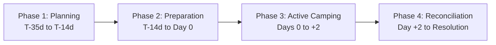

# Camping Club 2.0 — Lifecycle-Aware Presentation Specification

## 1. Principles of Lifecycle Adaptation

A camping trip is a temporal journey spanning multiple weeks. The information most important to a camper evolves dramatically across four distinct phases:
1. When deciding whether to attend (Planning).
2. When packing and organizing logistics (Preparation).
3. When on-site in the park (Active Camping).
4. When reconciling costs and reimbursing peers (Post-Trip Reconciliation).

### Strict Navigation Stability Invariant
> **"Never hide or remove navigation tabs based on lifecycle stage. Adapt emphasis, ordering, and default callouts within the stable four-destination structure."**

A member navigating to `/trips/:id` can always access `Overview`, `Prepare`, `Activities`, and `Payments` at any time. The application dynamically adjusts the **landing banner**, **default expanded sections**, and **callout priority** to match the current temporal phase.

---

## 2. The Four Temporal Phases

### Phase 1: Planning & Commitment (T-35 Days to T-14 Days)
- **Camper Mental Model:** *"Am I going? Can I commit? Is the cabin secured?"*
- **Landing Card Callout:** Primary emphasis on RSVP toggle, registration deadline countdown, and cabin capacity.
- **Event Overview Emphasis:**
  - RSVP confirmation and attendance quorum progress.
  - Constitution acknowledgment signature banner.
  - Mandatory $50 cabin deposit instructions.
- **Default Tab:** `Overview`.

### Phase 2: Preparation & Readiness (T-14 Days to Day 0)
- **Camper Mental Model:** *"What am I cooking? Who am I riding with? What do I need to pack?"*
- **Landing Card Callout:** Immediate focus on duty claims, carpool assignment, and packing progress.
- **Event Overview Emphasis:**
  - Next preparation tasks (e.g. `⚡ Choose your duty credit before Nov 08`).
  - Carpool departure time and passenger roster.
- **Default Tab:** `Prepare` (auto-expanding the incomplete accordion: Responsibilities, Transportation, or Gear/Packing).
- **Activities Destination:** Prominently highlights waiver signature deadlines and voucher collection.

### Phase 3: Active Camping (Day 0 to Day +2)
- **Camper Mental Model:** *"Where do I park? What is the gate code? What time is breakfast tomorrow?"*
- **Landing Card Callout:** Displays `🏕️ Currently Camping` badge with quick-access to Campsite Directions and Emergency Contacts.
- **Event Overview Emphasis:**
  - Park address, offline GPS coordinates, campsite number, and gate entry code.
  - Camp host contact name and direct phone dialer link.
  - Hospital and emergency services info.
- **Prepare Destination:** Prioritizes today's meal schedule and immediate duty assignments (e.g. `Tonight: Manmohan & John on Campfire & Dinner Cleanup`).

### Phase 4: Post-Trip Reconciliation (Day +2 to Resolution)
- **Camper Mental Model:** *"What do I owe? Who pays whom? Are receipts submitted?"*
- **Landing Card Callout:** Displays settlement status (`⚖️ Settlement Finalized · You owe $35.00` or `⏳ Awaiting Expense Submission`).
- **Event Overview Emphasis:** Direct callout navigating to the finalized settlement transfer instructions.
- **Default Tab:** `Payments` (focusing on the finalized settlement run, who-owes-whom instructions, `[Mark Sent]`, and `[Confirm Received]`).
- **Archive Status:** Once all transfers are confirmed and the retention clock begins, the trip moves to `Archived Trips` in the calendar history.
