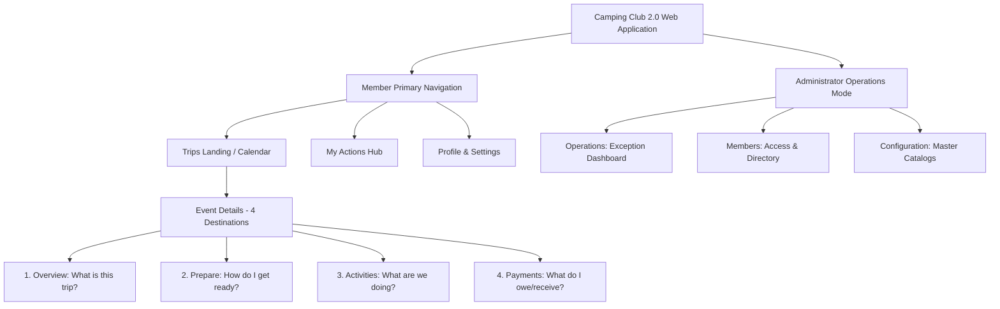
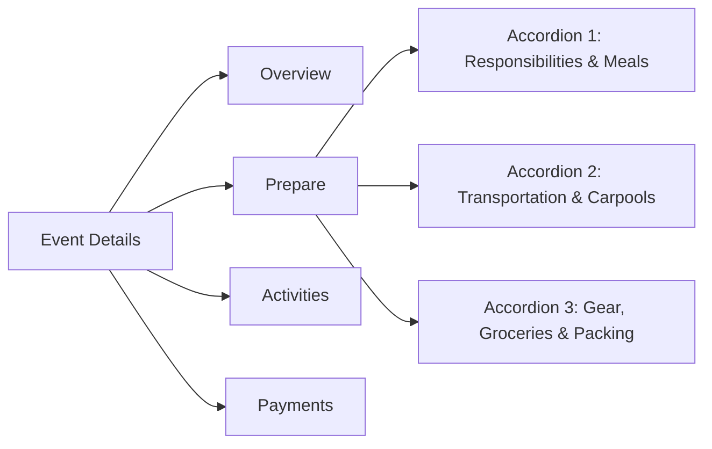

# Camping Club 2.0 — Navigation Architecture & UI Hierarchy

## 1. Top-Level Application Information Architecture

Camping Club 2.0 maintains a unified, role-aware navigation framework that eliminates information fragmentation while preserving one shared application experience for members, accountants, and administrators.

---

## 2. Member Primary Destinations

### A. Trips Landing Page (`/trips`)
- Displays all upcoming and rolling calendar trips in ascending chronological order.
- Each trip card features:
  - **Shortened Campsite Banner:** Compact 95px hero banner using actual photos from the Campsite Directory.
  - **Core Metadata:** Trip title, dates, location, cabin booking badge, and attendee count (`6 Going · 1 Waitlisted · Min 4 Met`).
  - **RSVP Quick-Toggle:** High-contrast `✓ Going` and `✕ Not Going` buttons.
  - **Contextual Next Action Pill:** Derived directly from the Action Resolution Service:  
    `⚡ Required From You: 1 chore commitment needed before Nov 01 · [Choose Chore]`
  - **Independent Deadline Row:** Clean footer displaying `Registration deadline: Nov 01, 2026 (Admin Override)` separated from the primary navigation button `[View Trip Details →]`.

### B. My Actions Hub (`/actions`)
- Centralized task inbox aggregating all outstanding actions across all active and upcoming trips.
- Grouped by urgency:
  - **Critical (Action Required):** Blocking deadlines (RSVP cutoff within 7 days, unsubmitted cabin deposit, unsigned mandatory activity waiver).
  - **Normal (Review Recommended):** Duty claiming, carpool seat selection, packing checklist review.
  - **Informational:** Published trip updates, packing recommendations.
- Every action card contains:
  - Trip title & dates badge.
  - Clear task title and explanation: *"Why am I seeing this?"*
  - Direct contextual action button navigating straight to the specific input drawer.

### C. Member Profile (`/profile`)
- Personal contact information, emergency contacts, vehicle details (make, model, seat capacity).
- Dietary restrictions and allergy tags.
- Encrypted payment handle management (Zelle email, Venmo handle) with strict privacy controls.

---

## 3. Event Details: The Four Destinations (`/trips/:tripId`)

Camping Club 2.0 consolidates the six 1.0 tabs into four clear, intuitive destinations:

### Destination 1: Overview (`?tab=overview`)
- **Core Question Answered:** *"What is this trip and what do I need to do?"*
- **Contents:**
  - Compact Trip Header: Dates, location, cabin booking status badge, attendee summary.
  - Personal RSVP & Status Banner: Current RSVP status with inline toggle.
  - **Contextual Next Steps Callout:** If tasks remain, displays individual links to the exact section:  
    `⚡ You have 2 pending items for this trip: [Select Responsibility →] · [Sign GoCar Waiver →]`  
    *(If items span multiple destinations, individual direct links or a link to My Actions is provided).*
  - Campsite & Cabin Reference: Collapsible card detailing address, gate code, check-in instructions, and camp host contact info.
  - Applicable Constitution Rule Bundle: Summary of rules applicable to this trip, with version number, hash, and signed acknowledgment timestamp.
  - Contextual Admin Drawer (`⚙️ Manage Trip Controls`): Expandable administrative controls for trip dates, cutoff overrides, cabin confirmation, and roster management.

### Destination 2: Prepare (`?tab=prepare`)
- **Core Question Answered:** *"How do I get ready?"*
- Structured into **three independently expandable accordion cards**, each displaying an authoritative summary when collapsed:
  1. **Responsibilities & Meals:**
     - *Default Summary:* `1 of 2 credits · 1 action required`
     - *Expanded Experience:* Daily workload progress bar, meal slots (Friday Dinner, Saturday Breakfast, Saturday Dinner, Sunday Breakfast), chore claiming interface, and driver workload credits (+1 credit for driving 3+ passengers).
  2. **Transportation & Carpools:**
     - *Default Summary:* `Carpool assigned · Departure 3:30 PM`
     - *Expanded Experience:* Vehicle roster, driver details, seat availability (4/5 seats filled), pickup locations, departure schedule, and passenger swap requests.
  3. **Gear, Groceries & Packing:**
     - *Default Summary:* `2 shared items claimed · Packing 5/7`
     - *Expanded Experience:*
       - Shared Camping Gear: Equipment claims (`Camp Stove`, `Water Jug`, `Lanterns`).
       - Groceries & Shared Supplies: Communal ingredient bundles and dietary preferences.
       - Personal Packing Checklist: Interactive personal checklist items (`Sleeping Bag`, `Hiking Boots`, `Warm Layers`).

### Destination 3: Activities (`?tab=activities`)
- **Core Question Answered:** *"What are we doing?"*
- **Contents:**
  - Signature activity schedule, location, and itinerary (e.g. GoCar Monterey Scenic Tour).
  - Participation status toggle (`Opt-In` / `Opt-Out`).
  - Vehicle & Partner Pairings: Assigned partner car roster with peer swap requests.
  - **Voucher Privacy & Tracking:** Redemption voucher input with masked code display (`GOCAR-****-9482`) and `[Reveal Code]` toggle.
  - **Waiver Compliance:** Distinct dual-status indicators:
    - Member Signed: `✓ Member Self-Reported (Oct 22)`
    - Operator Verified: `✓ Operator Call Sheet Confirmed (Oct 23)` (or `⚠️ Pending Call Sheet Check`).
  - Tour Operator Call Sheet Notes: Admin/Tour Lead coordination notes.

### Destination 4: Payments (`?tab=payments`)
- **Core Question Answered:** *"What do I owe or receive?"*
- **Contents:**
  - **Pre-Trip Cabin Contribution:** Status of the mandatory $50 deposit (`Submitted` vs `Verified by Accountant`).
  - **Post-Trip Settlement & Reimbursement:**
    - Finalized Settlement Run banner: `Run #RUN-2026-11-FINAL (Finalized Nov 16, 2026)`.
    - Content hash & solver metadata: `Settlement Engine v1.0.4 (Greedy Max-Flow)`.
    - Personal Net Balance: Clear integer-cent calculation (`You owe $35.00` or `You are owed $42.50`).
    - Clear Transfer Instructions: `Pay $35.00 to Manmohan (Cabin Host) via Zelle / Venmo`.
    - Workflow Action Buttons: `[Mark Transfer as Sent]` for payer, `[Confirm Received]` for payee/accountant.
  - **Itemized Ledger & Audit:** Collapsible ledger table with receipt attachments and per-member cost allocations.

---

## 4. Administrator Experience

Administrators access operational workflows via a top navigation mode switch:

### A. Admin Operations (`/admin/operations`)
- Exception-driven dashboard grouping actionable issues by trip and urgency:
  - **Deadlines:** Approaching contractual cabin cancellation deadlines (5-day warning) and registration cutoff alerts.
  - **Attendance:** Below-minimum participation warnings and waitlist promotion candidates.
  - **Financials:** Unverified cabin deposits and unfinalized settlement ledgers.
  - **Logistics:** Vacant critical chores, driver shortages, and unclaimed essential equipment.
  - **Activities:** Missing vouchers and unverified operator waivers.
- **Mobile Specification:** Action buttons are full-width and placed below the description with a minimum 44px height for comfortable touch interaction.

### B. Admin Members (`/admin/members`)
- Member directory, access approvals, role assignment (`member`, `accountant`, `admin`), and profile status.

### C. Admin Configuration (`/admin/configuration`)
Master card grid providing dedicated access to all 8 core configuration hubs:
1. **Camping Constitution:** Rule bundle editor, version publisher, and historical acknowledgment records.
2. **Campsite Directory:** 7-site rotation management, capacities, booking URLs, directions, and host contacts.
3. **Master Responsibilities:** Duty templates, workload credit weights, and time slot configurations.
4. **Camping Gear Catalog:** Master checklist items (individual vs shared equipment).
5. **Grocery Catalog:** Standard meal ingredient templates and communal supplies.
6. **Master Activities:** Reusable activity catalog, booking links, and waiver configurations.
7. **Club Schedule Defaults:** Rolling calendar rules, poll lead times, and cutoff buffers.
8. **Financial & Bank Defaults:** Assigned cabin payers, payment instruction templates, and fee rules.

---

## 5. Backward Compatibility & Route Aliasing

Camping Club 2.0 maintains 100% backward compatibility with all historical 1.0 URLs, bookmarked links, and email notification URLs via client-side route redirects:

| Legacy 1.0 Route | 2.0 Canonical Target | State / Focus Preserved |
| :--- | :--- | :--- |
| `/trips/:id` (default) | `/trips/:id?tab=overview` | Opens Overview tab |
| `/trips/:id/overview` | `/trips/:id?tab=overview` | Opens Overview tab |
| `/trips/:id/tasks` | `/trips/:id?tab=prepare` | Expands Responsibilities accordion |
| `/trips/:id/meals` | `/trips/:id?tab=prepare` | Expands Responsibilities & Meals accordion |
| `/trips/:id/duties` | `/trips/:id?tab=prepare` | Expands Responsibilities accordion |
| `/trips/:id/logistics` | `/trips/:id?tab=prepare` | Expands Transportation & Carpools accordion |
| `/trips/:id/carpools` | `/trips/:id?tab=prepare` | Expands Transportation & Carpools accordion |
| `/trips/:id/gear` | `/trips/:id?tab=prepare` | Expands Gear, Groceries & Packing accordion |
| `/trips/:id/groceries` | `/trips/:id?tab=prepare` | Expands Gear, Groceries & Packing accordion |
| `/trips/:id/packing` | `/trips/:id?tab=prepare` | Expands Gear, Groceries & Packing accordion |
| `/trips/:id/activities` | `/trips/:id?tab=activities` | Opens Activities tab |
| `/trips/:id/vouchers` | `/trips/:id?tab=activities` | Opens Activities tab focused on vouchers |
| `/trips/:id/financials` | `/trips/:id?tab=payments` | Opens Payments tab |
| `/trips/:id/settlement` | `/trips/:id?tab=payments` | Opens Payments tab focused on settlement run |
| `/trips/:id/constitution` | `/trips/:id?tab=overview` | Scrolls to Constitution acknowledgment card |
| `/admin/campsites` | `/admin/configuration?section=campsites` | Opens Campsite Directory editor |
| `/admin/rules` | `/admin/configuration?section=constitution` | Opens Master Constitution editor |
| `/admin/duties` | `/admin/configuration?section=duties` | Opens Master Responsibilities editor |
| `/admin/gear` | `/admin/configuration?section=gear` | Opens Camping Gear Catalog editor |
| `/admin/groceries` | `/admin/configuration?section=groceries` | Opens Grocery Catalog editor |
| `/admin/activities` | `/admin/configuration?section=activities` | Opens Master Activities editor |

---

## 6. Mobile Layout & Accessibility Requirements

- **Responsive 2×2 Destination Grid:** On viewports under 640px (iPhone/Android), the 4 destinations display as a 2×2 grid with clear active borders, eliminating horizontal truncation.
- **No Horizontal Scroll:** Guaranteed `scrollWidth <= innerWidth` across all pages.
- **Touch Targets:** All interactive controls, accordion toggles, and action buttons have a minimum touch target of 44×44px.
- **Full-Width Action Buttons:** Exception resolution buttons on mobile span 100% width and sit below the descriptive text, preventing awkward multi-column wrapping.
