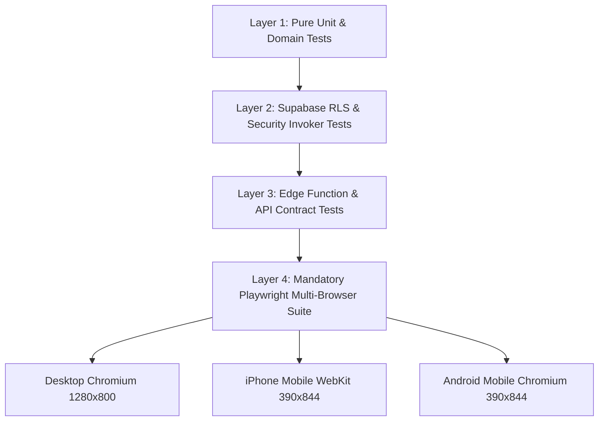

# Camping Club 2.0 — Test Strategy & Browser Acceptance Plan

## 1. Quality Assurance Governance

In strict adherence to repository rules and the **Mandatory Browser QA Certification Gate**:
- Passing unit, component, build, and database tests is necessary but **never sufficient** to certify a feature or release.
- Every user-facing feature must pass the automated Playwright browser acceptance suite (`npm run test:e2e`) across:
  1. **Desktop Chromium** (1280×800)
  2. **iPhone-sized Mobile WebKit** (390×844)
  3. **Android-sized Mobile Chromium** (390×844)
- **Sequential Execution:** Tests execute with `workers: 1` to ensure absolute determinism and prevent resource exhaustion on 8 GB Apple Silicon environments.

---

## 2. Multi-Layer Testing Architecture



### Layer 1: Pure Domain Unit Tests (`npm run test`)
- **Action Resolution Engine:** 100% test coverage for all 15 action rules. Verifies that actions trigger and clear deterministically.
- **Trip Health Engine:** Verifies that health state transitions (`on_track`, `needs_attention`, `at_risk`) evaluate correctly across all deadline and attendance edge cases.
- **Settlement Solver:** Verifies exact-cent integer math, Greedy Max-Flow optimization, and zero net balance conservation.

### Layer 2: Database RLS & Security Tests (`npm run test:db`)
- Direct Supabase Data API security tests verifying that unauthorized clients cannot write to financial tables or bypass trip-party predicates.
- Verification that sensitive payment handles in `private.payment_identities` cannot be selected by anon or authenticated roles.

### Layer 3: Browser Acceptance Suite (`npm run test:e2e`)

#### A. Durable Persistence Assertion
For every editable form or state toggle in 2.0:
1. The test fills and submits the form with realistic data containing spaces, parentheses, hyphens, and formatting.
2. The test verifies that the API call succeeds.
3. The test forces a hard browser reload:
   ```typescript
   await page.reload();
   ```
4. The test verifies that the saved data persists from PostgreSQL and renders completely intact on the reloaded page.
> **Rule:** Never certify a feature when an API call returns success but card reload displays stale or empty fields.

#### B. Mobile Viewport & Touch Target Assertions
On mobile viewport profiles (iPhone & Android):
1. **Horizontal Scroll Verification:**
   ```typescript
   const isOverflowing = await page.evaluate(() => document.documentElement.scrollWidth > window.innerWidth);
   expect(isOverflowing).toBe(false);
   ```
2. **Touch Target Sizing:**
   All buttons, accordion toggles, and input elements must have a rendered bounding box of at least 44×44px.

---

## 3. End-to-End Acceptance Test Scenarios

| Test ID | Scenario Description | Viewports Certified | Persistence & Reload Check |
| :--- | :--- | :--- | :--- |
| `E2E-ACT-01` | **Next Action Resolution:** Member RSVPs "Going"; verify immediate appearance of $50 deposit and chore actions; verify disappearance upon completion. | Desktop, iPhone, Android | Verified after `page.reload()` |
| `E2E-CARD-01` | **Calendar Card Usability:** Verify shortened hero banner (95px), RSVP quick-toggle, next action pill, and independent deadline row. | Desktop, iPhone, Android | Verified after `page.reload()` |
| `E2E-NAV-01` | **4-Destination Navigation:** Verify 2×2 mobile tab grid; verify `Payments` tab is fully discoverable; verify legacy 1.0 deep links redirect accurately. | Desktop, iPhone, Android | Full navigation path |
| `E2E-PREP-01` | **Prepare Accordions:** Expand Responsibilities accordion; claim a 2-credit kitchen duty; verify daily workload progress bar updates; verify driver workload credit calculation. | Desktop, iPhone, Android | Verified after `page.reload()` |
| `E2E-ACTV-01` | **Activities & Waivers:** Opt into GoCar tour; enter voucher code; verify masking (`****`); click waiver link; verify member self-report status; verify operator verification in Admin Ops. | Desktop, iPhone, Android | Verified after `page.reload()` |
| `E2E-SETTL-01` | **Payments & Final Settlement:** Open completed trip; verify personal net balance; verify who-owes-whom transfer instructions; click `[Mark Sent]`; verify accountant `[Confirm Received]`. | Desktop, iPhone, Android | Verified after `page.reload()` |
| `E2E-OPS-01` | **Admin Operations:** Trigger approaching cabin deadline; verify exception appearance; click full-width action button; resolve exception; verify dismissal. | Desktop, iPhone, Android | Verified after `page.reload()` |
| `E2E-CONF-01` | **Admin Configuration:** Navigate through all 8 configuration hubs; edit campsite details; verify persistence. | Desktop, iPhone, Android | Verified after `page.reload()` |

---

## 4. Failure Diagnostics

When any Playwright test fails:
1. Automated full-page screenshot captured at moment of failure.
2. Complete browser console logs and network activity recorded.
3. Playwright trace file (`trace.zip`) saved for time-travel debugging.
4. Video recording preserved in `test-results/`.
