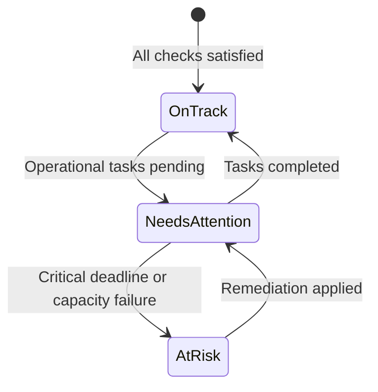

# Camping Club 2.0 — Trip Health & Risk Classification Specification

## 1. Objective & Non-Goals

The **Trip Health Engine** evaluates the aggregate operational, financial, and logistical readiness of an upcoming camping trip.

### Guiding Principles
- **No Arbitrary Percentages:** Readiness is never represented as a misleading single percentage (e.g., "78% Ready"). A trip with 95% of chores filled but an unconfirmed cabin reservation is **At Risk**, not "almost ready".
- **Rule-Based Discrete States:** Every trip is evaluated into one of three discrete, explainable states:
  1. `on_track` (Green)
  2. `needs_attention` (Amber / Yellow)
  3. `at_risk` (Red)
- **Zero Policy Alteration:** The Trip Health Engine is strictly diagnostic. It does not automatically cancel trips, forfeit deposits, or bypass required administrative decisions.

---

## 2. Health Classification Matrix



### State 1: `at_risk` (Red)
A trip is classified as **At Risk** if any condition threatens the viability of the trip, risks contractual financial forfeiture, or violates core club safety:

| Condition ID | Trigger Logic | Structured "Why?" Explanation | Remediation Action |
| :--- | :--- | :--- | :--- |
| `RISK-CABIN-DEADLINE` | Contractual cabin cancellation deadline is within 5 days AND confirmed RSVPs < minimum threshold (4). | "Trip has only {rsvpCount} RSVPs (minimum {minParticipants}). Contractual cabin cancellation penalty applies after {cabinDeadline}." | Extend deadline, initiate outreach, or cancel cabin before penalty. |
| `RISK-CABIN-STATUS` | Trip is `confirmed`, but cabin booking status is `no_vacancy` or `cancelled`. | "Trip is marked Confirmed, but the cabin reservation has no vacancy or was cancelled." | Book alternative site or cancel trip in Admin Controls. |
| `RISK-POST-CONF-DROP` | Trip previously confirmed, but member withdrawals dropped attendance below minimum. | "Confirmed attendance dropped to {rsvpCount} (below minimum {minParticipants}) following withdrawals." | Admin proceed/cancel decision required under Club Constitution. |
| `RISK-CRITICAL-DUTY` | Trip departs in < 48 hours AND critical life-safety duties (Water, First Aid) are vacant. | "Critical safety duties are unclaimed within 48 hours of departure." | Assign emergency duties in Admin Operations. |

---

### State 2: `needs_attention` (Amber / Yellow)
A trip is classified as **Needs Attention** when the trip is viable, but operational, financial, or readiness tasks remain incomplete as deadlines approach:

| Condition ID | Trigger Logic | Structured "Why?" Explanation | Remediation Action |
| :--- | :--- | :--- | :--- |
| `WARN-REG-CUTOFF` | Registration cutoff is within 7 days AND RSVPs < minimum threshold. | "Registration cutoff is {pollDeadlineAt} ({daysLeft} days remaining). {spotsNeeded} more RSVP(s) needed." | Send reminder notice to members. |
| `WARN-UNVERIFIED-DEP` | Confirmed attendees have submitted deposits awaiting accountant verification. | "{count} member deposit(s) awaiting verification by the club accountant." | Review bank receipts in Payments tab. |
| `WARN-CHORE-DEFICIT` | Trip departs in < 7 days AND vacant duty credits remain unassigned. | "{vacantCredits} duty credit(s) remain unclaimed across meal and camp duties." | Claim duties in Prepare tab. |
| `WARN-CARPOOL-SEATS` | Confirmed campers exceed registered vehicle seat capacities. | "{camperCount} campers confirmed, but vehicles only provide {seatCount} seats." | Request additional drivers in Prepare tab. |
| `WARN-VOUCHER-MISSING` | Signature activity opted-in campers have missing redemption vouchers. | "{missingCount} attendee(s) have not entered required tour voucher codes." | Enter vouchers in Activities tab. |
| `WARN-WAIVER-PENDING` | Opted-in attendees have unverified operator liability waivers. | "{unverifiedCount} tour liability waiver(s) unverified on the operator call sheet." | Verify signatures on Tour Call Sheet. |

---

### State 3: `on_track` (Green)
A trip is classified as **On Track** only when:
1. Minimum participant threshold is met or exceeded.
2. Cabin booking is verified and marked `booked`.
3. 100% of confirmed attendee deposits are verified.
4. 100% of required duty credits are claimed.
5. All vehicle seating requirements are balanced.
6. All required tour vouchers and waivers are operator-verified.
7. No active critical deadlines are overdue.

> [!NOTE]
> If any critical data point is unknown or unverified (e.g. cabin availability status is unknown), the system must **fail closed** to `needs_attention`, never defaulting to `on_track`.

---

## 3. UI Display & Explanation Format

On both the **Trips Landing Page** and the **Event Overview**, trip health is displayed as an accessible status pill with an expandable disclosure:

```
[ ⚠️ Needs Attention ]
• 2 deposits awaiting verification
• 1 duty credit unclaimed (Saturday Dinner Cook)
• 1 waiver unverified for GoCar Tour
[Review All 3 Exceptions →]
```

Clicking `[Review All Exceptions →]` opens the dedicated **Admin Operations** exception drawer or filters the member's **Prepare** view.
